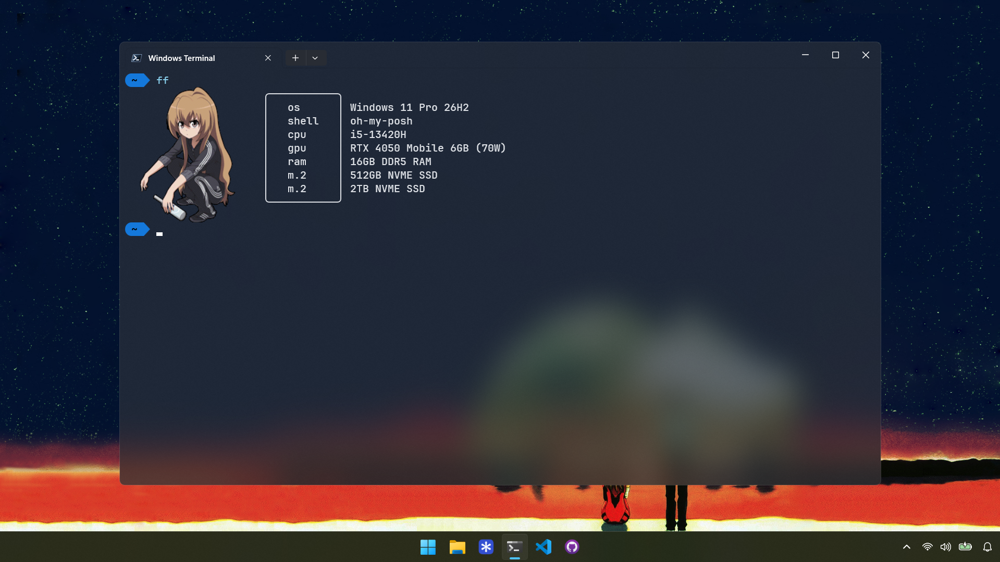

<div align="center">

# Fastfetch Windows Terminal Setup

A minimal fastfetch layout with an image logo, built for Windows Terminal on Windows 11.



</div>

## About

This is my terminal setup for Windows 11. It pairs a boxed, icon-free fastfetch layout and an image logo with an Oh My Posh prompt, all running in Windows Terminal with PowerShell 7.

It works with Windows Terminal on Windows 11. The logo is drawn with Sixel, which Windows Terminal supports from version 1.22.

## Features

- Image logo instead of ASCII art, drawn with Sixel
- Boxed layout with a white border
- Lists OS, shell, CPU, dedicated GPU, integrated GPU, RAM, and both SSDs
- No Nerd Font icons needed, so there are no missing-glyph question marks
- Prompt styled with Chris Titus's Oh My Posh PowerShell profile

## Tech Stack

| Part | Choice |
| --- | --- |
| OS | Windows 11 |
| Terminal | Windows Terminal (1.22 or newer) |
| Shell | PowerShell 7 |
| Prompt | Oh My Posh, using Chris Titus's PowerShell profile |
| System info | Fastfetch |
| Font | JetBrains Mono |

## Getting Started

### Requirements

- Windows 11
- [Windows Terminal](https://aka.ms/terminal) 1.22 or newer (needed for Sixel images)
- PowerShell 7: `winget install Microsoft.PowerShell`
- Oh My Posh with Chris Titus's profile
- JetBrains Mono font
- Fastfetch

### 1. Install Oh My Posh with Chris Titus's profile

Follow the instructions in [ChrisTitusTech/powershell-profile](https://github.com/ChrisTitusTech/powershell-profile). At the time of writing, the setup is a single command run in an elevated PowerShell window:

```powershell
irm "https://github.com/ChrisTitusTech/powershell-profile/raw/main/setup.ps1" | iex
```

### 2. Install the font

Download [JetBrains Mono](https://www.jetbrains.com/lp/mono/) or install it with winget:

```powershell
winget install JetBrains.JetBrainsMono
```

Then set it in Windows Terminal under Settings, Profiles, PowerShell, Appearance, Font face. Close and reopen the terminal afterwards.

### 3. Install fastfetch

```powershell
winget install fastfetch
```

### 4. Copy the config

Clone or download this repo, then copy the config and the logo image into fastfetch's config folder:

```powershell
New-Item -ItemType Directory -Force "$env:USERPROFILE\.config\fastfetch"
Copy-Item .\config.jsonc, .\aisaka.png "$env:USERPROFILE\.config\fastfetch\"
```

Open `config.jsonc` and change the `source` path so it points to your own user folder:

```jsonc
"source": "C:/Users/YourName/.config/fastfetch/aisaka.png"
```

### 5. Run it

```powershell
fastfetch
```

## Project Structure

```
.
├── README.md          # This file
├── desktopsetup.png   # Screenshot shown at the top
├── config.jsonc       # Fastfetch config (layout, colors, logo settings)
└── aisaka.png         # Image used as the logo
```

## Known Limitations

- The hardware lines (CPU, GPUs, RAM, SSDs) are typed in by hand, so they will not match your machine. Edit the `format` values in `config.jsonc` to match your own specs.
- The image path in the config is absolute. If it is wrong, fastfetch falls back to its default ASCII logo.
- Sixel only works in Windows Terminal 1.22 or newer. In WezTerm, change `"type": "sixel"` to `"type": "iterm"`.
- GIFs are not animated. Fastfetch only shows a still image as the logo.

## License

Released under the [MIT License](LICENSE).